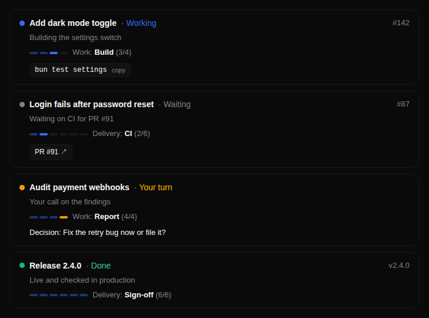
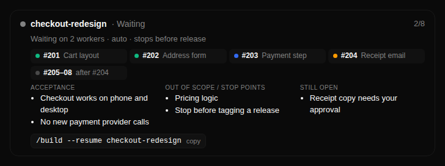
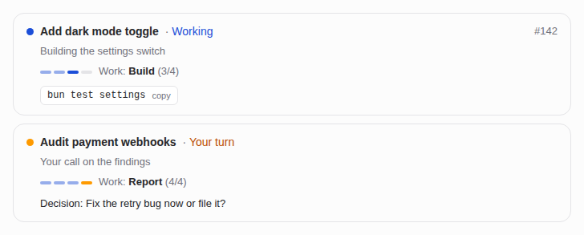

# t3-status-card

A compact status card your coding agent renders at the end of a task in [T3 Code](https://github.com/pingdotgg/t3code). It shows what the task is, where it stands, whose turn it is, and the next step, with a one-click copy button for the next command.



## Set it up

Paste this to your agent in T3 Code:

> Read https://github.com/timvdhoorn/t3-status-card/blob/main/AGENT-SETUP.md and set up the status card for me.

The agent adds a short rule to your global instructions and renders a test card. To do it by hand, copy the rule from [AGENT-SETUP.md](AGENT-SETUP.md).

## How it works

The script is loaded from jsDelivr, so each card only sends a few fields (about 100 tokens):

```html
<script src="https://cdn.jsdelivr.net/gh/timvdhoorn/t3-status-card@v7/s.js"></script>
<script>S({y:"fix",t:"Login fails after reset",i:"#87",p:3,s:"a",x:"bun test auth"})</script>
```

- `S()` renders a task card: type, title, issue ref, work phase or delivery step, state, and the next command, decision or link.
- `R()` renders a run card for multi-issue runs: an issue grid with an accepted count, acceptance criteria, stop points and open points.



Field reference: the header of [`s.js`](s.js). Labels are English; add `?lang=nl` to the script URL for Dutch. The card follows the T3 light and dark themes.



## Limits

- The card runs in T3's sandboxed `html_render` frame. It can copy text and open http(s) links, nothing else: no buttons that start threads or send prompts.
- T3 folds text written before a tool call under "Worked for", so the card goes directly above the agent's final reply, not below it.

Version history: [CHANGELOG.md](CHANGELOG.md). License: MIT.
